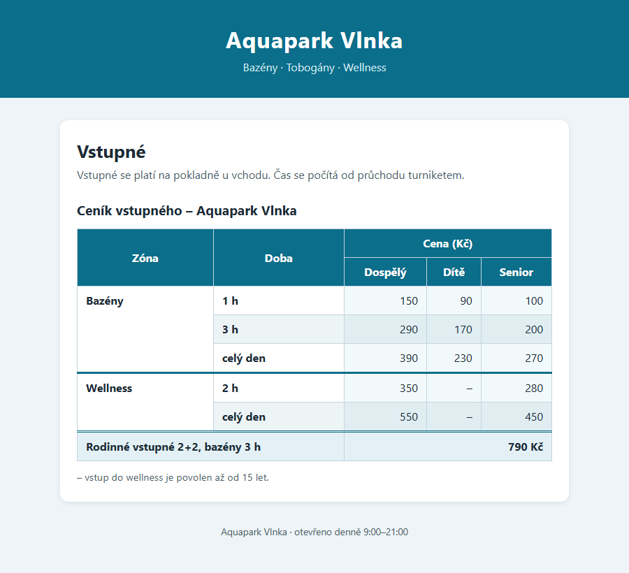
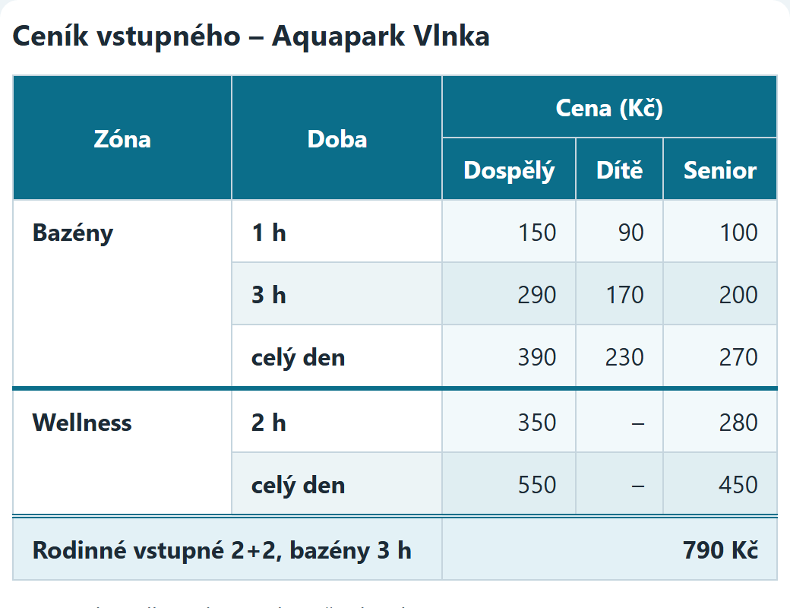

# Praktická úloha: Ceník aquaparku

**Čas:** cca 25 minut (část A ~14 min, část B ~8 min, kontrola ~3 min)

Aquapark Vlnka chce na web ceník vstupného. Stránka je hotová (banner, úvodní text, poznámka, zápatí), chybí jen tabulka a její vzhled. Vaším úkolem je:

- **část A:** v souboru `zadani/index.html` napsat tabulku (úkoly 1–5),
- **část B:** v souboru `zadani/style.css` doplnit její vzhled (úkoly 6–11).

## Jak začít

1. Otevřete složku `zadani` v editoru (např. VS Code).
2. Soubor `index.html` otevřete v prohlížeči (dvojklik). Po každé změně stránku obnovte klávesou F5.
3. Nic se neinstaluje a nepotřebujete internet.

## Výsledek



Detail tabulky:



## Schéma tabulky

```
            Ceník vstupného – Aquapark Vlnka               ← <caption>
┌───────────┬───────────┬─────────────────────────────┐
│ Zóna      │ Doba      │    Cena (Kč), colspan=3     │ ← <thead>
│ rowspan=2 │ rowspan=2 ├──────────┬────────┬─────────┤
│           │           │ Dospělý  │  Dítě  │ Senior  │
╞═══════════╪═══════════╪══════════╪════════╪═════════╡
│ Bazény    │ 1 h       │      150 │     90 │     100 │ ← 1. <tbody>
│ rowspan=3 │ 3 h       │      290 │    170 │     200 │
│           │ celý den  │      390 │    230 │     270 │
╞═══════════╪═══════════╪══════════╪════════╪═════════╡
│ Wellness  │ 2 h       │      350 │      – │     280 │ ← 2. <tbody>
│ rowspan=2 │ celý den  │      550 │      – │     450 │
╞═══════════╧═══════════╪══════════╧════════╧═════════╡
│ Rodinné vstupné 2+2,  │           790 Kč            │ ← <tfoot>
│ bazény 3 h, colspan=2 │          colspan=3          │
└───────────────────────┴─────────────────────────────┘
```

## Část A – HTML (`zadani/index.html`)

Data najdete v komentáři v `index.html`, přímo v místě, kam tabulku píšete.

1. **Tabulka a titulek:** vytvořte `<table>` a v ní jako první prvek `<caption>` s textem „Ceník vstupného – Aquapark Vlnka“.
2. **Sloupce:** přidejte `<colgroup>` se dvěma `<col>`: první pokrývá první 2 sloupce (`span="2"`), druhý 3 cenové sloupce (`span="3"`) a má `class="prices"`.
3. **Hlavička `<thead>`** se dvěma řádky:
   - 1. řádek: `Zóna` a `Doba` přes 2 řádky (`rowspan="2"`), `Cena (Kč)` přes 3 sloupce (`colspan="3"`),
   - 2. řádek: `Dospělý`, `Dítě`, `Senior`,
   - všechny buňky hlavičky jsou `<th>`; `Cena (Kč)` má `scope="colgroup"`, ostatní `scope="col"`.
4. **Tělo, dvě `<tbody>`:** jedno pro Bazény, druhé pro Wellness.
   - Název zóny je `<th>` přes všechny řádky své skupiny (`rowspan`) se `scope="rowgroup"`.
   - Doba (`1 h`, `3 h`, `celý den`…) je `<th scope="row">`.
   - Ceny jsou `<td>`. Kde cena není, napište pomlčku `–`.
5. **Patička `<tfoot>`** s jedním řádkem: `<th scope="row">` s textem „Rodinné vstupné 2+2, bazény 3 h“ přes 2 sloupce a `<td>` s textem „790 Kč“ přes 3 sloupce.

Nepoužívejte zastaralé atributy (`border`, `cellpadding`, `align`, `bgcolor`…), vzhled patří do CSS.

## Část B – CSS (`zadani/style.css`)

Vzhled stránky je hotový, doplňujete jen sekci **VZHLED TABULKY**. Rozměry jsou přesně dané (najdete je i v komentářích v `style.css`).

**Barvy** jsou připravené na začátku `style.css` jako CSS proměnné v `:root`. Nepište hex kódy, použijte proměnnou přes `var()`, např. `color: var(--color-white);`.

| Proměnná | Hodnota | Kde se použije |
|---|---|---|
| `--color-primary` | `#0b6e8a` | pozadí hlavičky, silné čáry |
| `--color-white` | `#ffffff` | písmo v hlavičce |
| `--color-border` | `#c5d5de` | rámečky buněk |
| `--color-prices-bg` | `#f2f9fb` | pozadí cenových sloupců |
| `--color-zebra` | `rgba(11, 110, 138, 0.08)` | sudé řádky |
| `--color-tfoot-bg` | `#e3f1f6` | pozadí patičky |
| `--color-hover` | `rgba(11, 110, 138, 0.18)` | řádek pod myší (bonus) |

6. **Tabulka:** šířka 100 %, okraje sousedních buněk slité do jedné čáry (`border-collapse`).
7. **Titulek:** nad tabulkou (`caption-side`), zarovnaný vlevo, velikost `1.2rem`, tučně, odsazení dole `12px`.
8. **Buňky** (`th`, `td`): rámeček `1px solid` v barvě `--color-border`, vnitřní odsazení `8px 12px`.
9. **Záhlaví:**
   - `th` v `thead`: pozadí `--color-primary`, písmo `--color-white`, zarovnání na střed,
   - `th` v `tbody` a `tfoot`: zarovnání vlevo,
   - sloučené buňky zón (selektor `th[scope="rowgroup"]`): svisle nahoru.
10. **Čísla, sloupce a zebra:**
    - `td`: zarovnání vpravo,
    - `col.prices`: pozadí `--color-prices-bg`,
    - sudé řádky v `tbody`: pozadí `--color-zebra` (poloprůhledná barva, aby prosvítalo pozadí cenových sloupců).
11. **Skupiny řádků a patička:**
    - `tbody`, které následuje po jiném `tbody` (selektor `tbody + tbody`): horní okraj `3px solid` v barvě `--color-primary`,
    - `tfoot`: horní okraj `3px double` v barvě `--color-primary`, tučné písmo, pozadí `--color-tfoot-bg`.

**Bonus (když zbude čas):**

- řádek v `tbody` pod myší zvýrazněte pozadím `--color-hover`,
- čísla v `td` vysázejte se stejně širokými číslicemi (`font-variant-numeric: tabular-nums`).

## Kontrolní seznam

- [ ] tabulka má `caption`, `colgroup`, `thead`, dvě `tbody` a `tfoot` ve správném pořadí
- [ ] všechna záhlaví jsou `th` se správným `scope`, data jsou v `td`
- [ ] `rowspan` a `colspan` jsou na správných místech; tabulka nemá díry ani přesahy (každý řádek = 5 sloupců)
- [ ] v HTML nejsou zastaralé atributy
- [ ] okraje buněk jsou slité do jedné čáry, buňky mají odsazení
- [ ] titulek je vlevo nad tabulkou
- [ ] hlavička je barevná, čísla jsou vpravo, názvy zón nahoře
- [ ] cenové sloupce mají pozadí, sudé řádky zebru
- [ ] skupiny Bazény a Wellness odděluje silná čára, patička je tučná s dvojitou čarou

## Řešení

Hotové řešení je ve složce [`reseni`](reseni/), postup krok za krokem v [`reseni/VYSVETLENI.md`](reseni/VYSVETLENI.md).